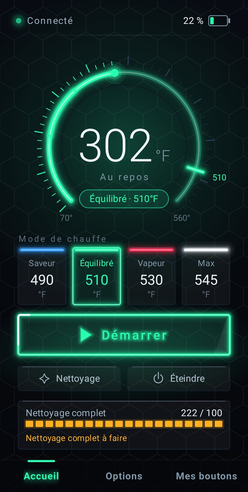
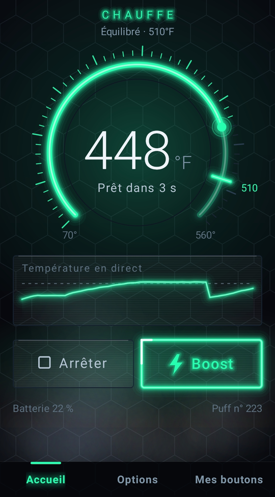
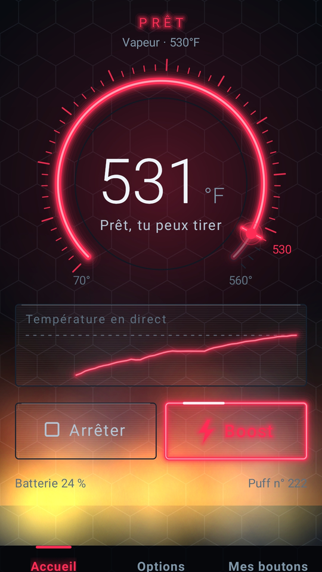
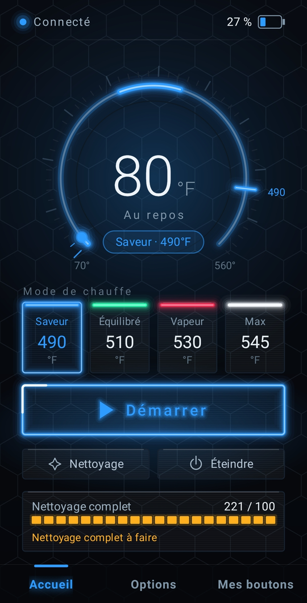
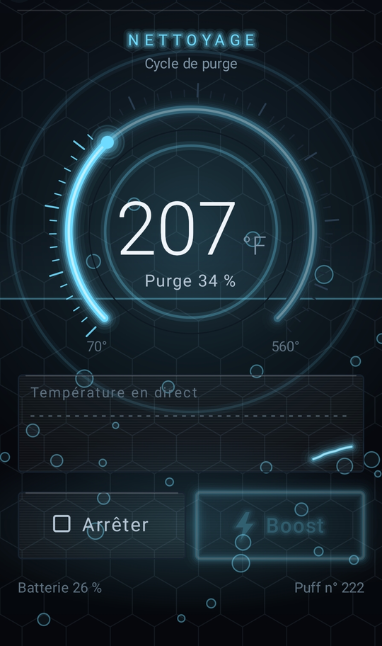

<h1 align="center">Proxy</h1>

<p align="center">
  <b>An unofficial, open-source Android app for the Puffco Proxy — made for the phones the official app leaves behind, like the Huawei P30 stuck on Android 10.</b>
</p>

<p align="center">
  
  
  
  
</p>

<p align="center">
  <a href="https://github.com/Furycom/proxy-android/releases/latest"></a>
</p>

<p align="center">
  <a href="#english">English</a> · <a href="#français">Français</a>
</p>

<p align="center">
  
  
  
</p>
<p align="center">
  
  
</p>
<p align="center"><sub>Each heat mode has its own neon color. / Chaque mode de chauffe a sa propre couleur néon.</sub></p>

---

## English

### Why this app exists

The official app does not install on some Android 10 phones. At the time of writing, the manufacturer's compatibility page describes the app both as supporting "Android 10+" and as "designed for Android 12+", which leaves Android 10 owners unsure whether their phone is supported — and, in practice, some of them simply cannot install it.

**Proxy** fills that gap. It talks to the device directly over Bluetooth Low Energy, runs on Android 10 and up (tested from Android 10 to Android 17), and needs no account and no Internet connection.

### Still on a Huawei P30? This app is for you.

Android is now at version 17, but many perfectly good phones will never see another update. The Huawei P30 and P30 Pro — the last Huawei flagships released with Google services — stopped at **Android 10**. Their later EMUI 11 update kept the same Android 10 base. Plenty of these phones are still in daily use, with great cameras and plenty of life left in them.

If that's your phone, you shouldn't have to buy a new one just to control your Proxy. **Proxy** was built and tested on a Huawei P30, and it uses only standard Android features:

- **No Google Play Services required.** The app relies only on the Android system itself, nothing from Google.
- **No account, no Internet, no tracking.** Everything stays between your phone and your device.
- **Lightweight.** A single small APK, under 1 MB.

### Features

- **Automatic connection** — finds your Proxy, remembers it, and reconnects on its own when the link drops.
- **Heat modes at a glance** — the four modes with their color and real temperature; switch with one tap.
- **Start, stop and Boost** — on-screen buttons for every action of the physical button.
- **Live session screen** — a gauge, live temperature, smoke and glow effects while the device heats.
- **Battery and puff counter** — battery level, total puffs, and a reminder for a full cleaning every 100 puffs.
- **Cleaning cycle** — heats a mode and stops automatically halfway, the way a cleaning cycle should.
- **Lights** — brightness, stealth mode and lantern. *Known issue: the lantern switch always shows "off" in the app; a fix is planned for v1.1.*
- **"My buttons" page** — what each gesture on the device does, with the on-screen button that replaces it.
- **Designed with care** — hand-drawn Canvas rendering: neon accents in the color of the active mode, hexagon textures, smooth animations. No third-party libraries.
- **Stays connected in the background** — a small foreground notification keeps the link alive while you use your phone.

> The interface is currently in French.

### Installation

1. Download **`Proxy-v1.0.apk`** from the [latest release](../../releases/latest).
2. Open the file on your phone. If Android asks, allow your browser or file manager to **install unknown apps** (Settings → Apps → Special access → Install unknown apps).
3. Open **Proxy**, turn on your device, and accept the permissions below.

You can check the download against the SHA-256 checksum published with each release.

#### Permissions and why they are needed

| Permission | Why |
|---|---|
| Nearby devices (`BLUETOOTH_SCAN`, `BLUETOOTH_CONNECT`) — Android 12+ | Find and connect to your Proxy. Scanning is declared `neverForLocation`: it is not used to locate you. |
| Location (`ACCESS_FINE_LOCATION`) — Android 10 and 11 only | On these versions Android requires it for any Bluetooth scan. The app never reads your location. |
| Notifications (`POST_NOTIFICATIONS`) — Android 13+ | Show the "connected" notification. Refusing it does not block Bluetooth. |
| Foreground service (`FOREGROUND_SERVICE`, `…_CONNECTED_DEVICE`) | Keep the Bluetooth link alive while the app is in the background. |

### Compatibility

- Android 10 and up (min SDK 29, target SDK 34).
- Tested on a Huawei P30 (Android 10, EMUI) and on an Android 17 phone.
- Does not need Google Play Services.
- Requires a phone with Bluetooth Low Energy.

### Build from source

The app is built **without Gradle**, with the Android SDK command-line tools only (`aapt2`, `kotlinc`, `d8`, `zipalign`, `apksigner`), driven by [`build.ps1`](build.ps1) on Windows PowerShell.

**Requirements**

- Android SDK with `platforms;android-34` and `build-tools;34.0.0`
- JDK 17 or newer
- Kotlin compiler (`kotlinc`, tested with 1.9.24)

**Tell the script where the tools are** — any of these, first one found wins:

1. Parameters: `.\build.ps1 -Sdk <sdk> -Jdk <jdk> -Kotlinc <kotlinc>`
2. A `local.properties` file next to the script with `sdk.dir`, `jdk.dir`, `kotlinc.dir` (ignored by git)
3. Environment variables `ANDROID_HOME` (or `ANDROID_SDK_ROOT`), `JAVA_HOME`, `KOTLIN_HOME`

**Provide your own signing key** — no key is included in this repository. Create one, for example:

```powershell
keytool -genkeypair -keystore my-release.jks -storetype PKCS12 -alias my-key `
        -keyalg RSA -keysize 4096 -validity 10950 -dname "CN=Your Name"
```

Then either set the environment variables `PROXY_KEYSTORE`, `PROXY_KS_PASS`, `PROXY_KEY_ALIAS` (and `PROXY_KEY_PASS` if different), or create a `keystore.properties` file next to the script (ignored by git):

```properties
storeFile=my-release.jks
storePassword=...
keyAlias=my-key
keyPassword=...
```

The script hands the secret to `apksigner` through an environment variable, never on the command line. Run `.\build.ps1`; the signed APK lands in `build\Proxy-v1.0.apk`.

> An APK signed with your own key cannot be installed over the official release build (Android requires the same signature for updates). Uninstall the other build first.

The Gradle files are kept so the project opens in Android Studio; the reference build is `build.ps1`.

### Roadmap — v1.1 (planned)

Version 1.1 is already in the works, focused on making the app feel even better:

- **Smoother animations** — a higher, steadier frame rate on every screen.
- **Major visual polish** across the whole interface.
- **Session history & statistics** — daily, weekly, monthly and yearly totals with charts, streaks, favorite time of day, average duration and temperature — stored on your phone only.

No release date yet: it ships when it is ready.

### Privacy

- **No Internet access.** The app does not request the `INTERNET` permission, so it cannot send anything anywhere.
- **No data collected**, no account, no analytics, no ads.
- The app reads your device's status (battery, temperature, puff counter…) and sends it only the commands you trigger yourself: start, stop, heat modes, cleaning, resetting the cleaning counter, lights. Nothing leaves your phone: there is no Internet connection at all.
- App backups are disabled (`allowBackup="false"`). On your phone, the app keeps only your Proxy's Bluetooth address (to reconnect) and, if your device does not provide its own cleaning counter, a reference puff count used to compute it.

### Disclaimer

This is an **unofficial** app. It is **not affiliated with, endorsed by, or approved by Puffco**. "Puffco" and "Proxy" are trademarks of their respective owners and are used here only to describe compatibility.

The app only uses the device's normal Bluetooth commands. It **never modifies or updates the device's firmware** and never touches its heater tuning or factory settings.

The software is provided "as is", without warranty of any kind (see [LICENSE](LICENSE)). **Use it at your own risk.**

### Acknowledgements

- [**puffco-py**](https://github.com/SoyMilkIsOk/puffco-py) (MIT) — its open-source work on the Bluetooth protocol was a precious guide to how the device's data is organized and encoded.
- Further details — including the settings an app must never touch — came from studying how the official web app talks to the device, and from reading the device's own answers over Bluetooth.

No third-party code is included, from puffco-py or from the official app: the whole app is original Kotlin.

### Credits

Built with **Claude Code** (Anthropic), directed and tested by **Furycom**.

### FAQ

**Is it safe?**

The app never modifies or updates your device's firmware, and never touches its heater tuning or factory settings — it only uses the device's normal Bluetooth commands. It has no Internet access at all, so nothing can leave your phone. And the whole source code is right here, open for anyone to read.

**Why is it not on Google Play?**

Google Play is not available on many of the phones this app was made for, such as Huawei phones without Google services. Publishing the APK directly on GitHub lets anyone install it, with nothing in between.

**Will it work on my phone?**

Most likely, if your phone runs Android 10 or newer and has Bluetooth Low Energy (almost every phone from the last ten years does). It has been tested on a Huawei P30 (Android 10, EMUI) and on an Android 17 phone. If it doesn't work on yours, please [tell us](https://github.com/Furycom/proxy-android/issues/new?template=bug_report.yml) — that helps everyone.

**How do I update?**

Download the new APK from the [Releases](https://github.com/Furycom/proxy-android/releases) page and install it over the old one. To be notified automatically, you can add this repository to [Obtainium](https://github.com/ImranR98/Obtainium), which installs updates straight from GitHub Releases.

### Support the project

- ⭐ **Star this repository** — it helps other people with an older phone find the app.
- 🐞 **Report bugs and share ideas** in [Issues](https://github.com/Furycom/proxy-android/issues), or ask questions in [Discussions](https://github.com/Furycom/proxy-android/discussions).

### License

[MIT](LICENSE) © 2026 Furycom

---


## Français

### Pourquoi cette application

L'application officielle ne s'installe pas sur certains téléphones Android 10. Au moment d'écrire ces lignes, la page de compatibilité du fabricant présente l'application à la fois comme compatible « Android 10+ » et comme « conçue pour Android 12+ » : les propriétaires d'un Android 10 ne savent pas si leur téléphone est pris en charge, et certains ne peuvent tout simplement pas l'installer.

**Proxy** comble ce vide. Elle parle directement à l'appareil en Bluetooth basse consommation (BLE), fonctionne à partir d'Android 10 (testée d'Android 10 à Android 17), sans compte et sans connexion Internet.

### Encore sur un Huawei P30 ? Cette application est pour vous.

Android en est à la version 17, mais beaucoup de bons téléphones ne recevront plus jamais de mise à jour. Les Huawei P30 et P30 Pro, derniers modèles phares de Huawei vendus avec les services Google, se sont arrêtés à **Android 10**. Leur mise à jour EMUI 11 est restée sur cette même base Android 10. Une foule de ces téléphones servent encore tous les jours, avec un excellent appareil photo et encore de belles années devant eux.

Si c'est votre téléphone, vous ne devriez pas avoir à en acheter un neuf juste pour piloter votre Proxy. **Proxy** a été conçue et testée sur un Huawei P30, et n'utilise que des fonctions standard d'Android :

- **Aucun service Google Play requis.** L'application ne s'appuie que sur le système Android lui-même, rien de Google.
- **Aucun compte, aucun Internet, aucun pistage.** Tout reste entre votre téléphone et votre appareil.
- **Légère.** Un seul petit APK, moins de 1 Mo.

### Fonctionnalités

- **Connexion automatique** — trouve votre Proxy, le mémorise et se reconnecte toute seule si le lien coupe.
- **Modes de chauffe d'un coup d'œil** — les quatre modes, avec leur couleur et leur vraie température ; on change d'un toucher.
- **Démarrer, arrêter, Boost** — un bouton à l'écran pour chaque geste du bouton physique.
- **Écran de session en direct** — jauge, température en direct, fumée et lueur pendant la chauffe.
- **Batterie et compteur de puffs** — niveau de batterie, total des puffs et rappel de nettoyage complet tous les 100 puffs.
- **Cycle de nettoyage** — chauffe un mode et s'arrête tout seul à mi-chemin.
- **Lumières** — intensité, mode discret et lanterne. *Problème connu : l'interrupteur de la lanterne affiche toujours « éteint » dans l'application ; correction prévue en 1.1.*
- **Page « Mes boutons »** — ce que fait chaque geste sur l'appareil, et le bouton qui le remplace à l'écran.
- **Soignée dans les détails** — rendu Canvas dessiné à la main : néons à la couleur du mode actif, textures d'hexagones, animations fluides. Aucune bibliothèque tierce.
- **Reste connectée en arrière-plan** — une petite notification garde le lien actif pendant que vous utilisez votre téléphone.

> L'interface est en français.

### Installation

1. Téléchargez **`Proxy-v1.0.apk`** dans la [dernière version publiée](../../releases/latest).
2. Ouvrez le fichier sur votre téléphone. Si Android le demande, autorisez votre navigateur ou votre gestionnaire de fichiers à **installer des applications inconnues** (Paramètres → Applications → Accès spécial → Installer des applis inconnues).
3. Ouvrez **Proxy**, allumez votre appareil et acceptez les autorisations ci-dessous.

Vous pouvez vérifier le fichier avec la somme SHA-256 publiée avec chaque version.

#### Autorisations demandées et pourquoi

| Autorisation | Pourquoi |
|---|---|
| Appareils à proximité (`BLUETOOTH_SCAN`, `BLUETOOTH_CONNECT`) — Android 12+ | Trouver le Proxy et s'y connecter. La recherche est déclarée `neverForLocation` : elle ne sert pas à vous localiser. |
| Localisation (`ACCESS_FINE_LOCATION`) — Android 10 et 11 seulement | Sur ces versions, Android l'exige pour toute recherche Bluetooth. L'application ne lit jamais votre position. |
| Notifications (`POST_NOTIFICATIONS`) — Android 13+ | Afficher la notification « connecté ». La refuser ne bloque pas le Bluetooth. |
| Service de premier plan (`FOREGROUND_SERVICE`, `…_CONNECTED_DEVICE`) | Garder le lien Bluetooth actif quand l'application est en arrière-plan. |

### Compatibilité

- Android 10 et plus (SDK minimum 29, cible 34).
- Testée sur un Huawei P30 (Android 10, EMUI) et sur un téléphone Android 17.
- N'a pas besoin des services Google Play.
- Exige un téléphone avec Bluetooth basse consommation.

### Compiler depuis les sources

L'application se compile **sans Gradle**, avec les seuls outils en ligne de commande du SDK Android (`aapt2`, `kotlinc`, `d8`, `zipalign`, `apksigner`), pilotés par [`build.ps1`](build.ps1) sous Windows PowerShell.

**Prérequis** : SDK Android avec `platforms;android-34` et `build-tools;34.0.0`, JDK 17 ou plus récent, compilateur Kotlin (`kotlinc`, testé avec la 1.9.24).

**Indiquer où sont les outils** — au choix, le premier trouvé l'emporte :

1. Paramètres : `.\build.ps1 -Sdk <sdk> -Jdk <jdk> -Kotlinc <kotlinc>`
2. Un fichier `local.properties` à côté du script avec `sdk.dir`, `jdk.dir`, `kotlinc.dir` (ignoré par git)
3. Les variables d'environnement `ANDROID_HOME` (ou `ANDROID_SDK_ROOT`), `JAVA_HOME`, `KOTLIN_HOME`

**Fournir votre propre clé de signature** — aucune clé n'est incluse dans ce dépôt. Créez-en une avec `keytool` (voir l'exemple de la section anglaise), puis définissez les variables `PROXY_KEYSTORE`, `PROXY_KS_PASS`, `PROXY_KEY_ALIAS` (et `PROXY_KEY_PASS` si différent), ou créez un fichier `keystore.properties` à côté du script (ignoré par git) avec `storeFile`, `storePassword`, `keyAlias`, `keyPassword`. Lancez `.\build.ps1` : l'APK signé se trouve dans `build\Proxy-v1.0.apk`.

> Un APK signé avec votre propre clé ne peut pas s'installer par-dessus la version publiée (Android exige la même signature pour une mise à jour). Désinstallez d'abord l'autre version.

### Feuille de route — v1.1 (prévue)

La version 1.1 est déjà en préparation, pour rendre l'application encore plus agréable :

- **Animations plus fluides** — plus d'images par seconde, et plus stables, sur tous les écrans.
- **Grosse amélioration visuelle** de toute l'interface.
- **Historique et statistiques des sessions** — totaux par jour, semaine, mois et année avec graphiques, séries de jours, moment préféré de la journée, durée et température moyennes — gardés sur votre téléphone seulement.

Pas de date pour l'instant : elle sortira quand elle sera prête.

### Confidentialité

- **Aucun accès à Internet.** L'application ne demande pas l'autorisation `INTERNET` : elle ne peut rien envoyer nulle part.
- **Aucune donnée collectée**, aucun compte, aucune statistique d'usage envoyée, aucune publicité.
- L'application lit l'état de votre appareil (batterie, température, compteur de puffs…) et ne lui envoie que les commandes que vous déclenchez vous-même : démarrer, arrêter, modes de chauffe, nettoyage, remise à zéro du compteur de nettoyage, lumières. Aucune donnée ne quitte votre téléphone : il n'y a aucune connexion Internet.
- Les sauvegardes de l'application sont désactivées (`allowBackup="false"`). Sur votre téléphone, elle ne garde que l'adresse Bluetooth de votre Proxy (pour s'y reconnecter) et, si votre appareil ne fournit pas son propre compteur de nettoyage, un nombre de puffs de référence qui sert à le calculer.

### Avertissement

Cette application est **non officielle**. Elle n'est **ni affiliée à Puffco, ni approuvée ou validée par Puffco**. « Puffco » et « Proxy » sont des marques de leurs propriétaires respectifs, citées ici seulement pour indiquer la compatibilité.

L'application n'utilise que les commandes Bluetooth normales de l'appareil. Elle **ne modifie et ne met jamais à jour le micrologiciel (firmware)** et ne touche jamais aux réglages de chauffe ni aux réglages d'usine.

Le logiciel est fourni « tel quel », sans aucune garantie (voir [LICENSE](LICENSE)). **Utilisation à vos risques.**

### Remerciements

- [**puffco-py**](https://github.com/SoyMilkIsOk/puffco-py) (MIT) — son travail libre sur le protocole Bluetooth a été un guide précieux pour comprendre comment les données de l'appareil sont organisées et codées.
- Les autres détails — dont les réglages qu'une application ne doit jamais toucher — viennent de l'étude de la façon dont l'application web officielle parle à l'appareil, et de la lecture des réponses de l'appareil lui-même.

Aucun code tiers n'est inclus, ni de puffco-py ni de l'application officielle : toute l'application est du Kotlin original.

### Crédits

Conçue avec **Claude Code** (Anthropic), dirigée et testée par **Furycom**.

### Questions fréquentes

**Est-ce sans danger ?**

L'application ne modifie et ne met jamais à jour le micrologiciel de votre appareil, et ne touche jamais aux réglages de chauffe ni aux réglages d'usine : elle n'utilise que ses commandes Bluetooth normales. Elle n'a aucun accès à Internet, donc rien ne peut quitter votre téléphone. Et tout son code source est ici, ouvert à qui veut le lire.

**Pourquoi n'est-elle pas sur Google Play ?**

Google Play n'existe pas sur bien des téléphones pour lesquels l'application a été faite, comme les Huawei sans services Google. Publier l'APK directement sur GitHub permet à tout le monde de l'installer, sans intermédiaire.

**Va-t-elle fonctionner sur mon téléphone ?**

Très probablement, si votre téléphone a Android 10 ou plus récent et le Bluetooth basse consommation (presque tous les téléphones des dix dernières années l'ont). Elle a été testée sur un Huawei P30 (Android 10, EMUI) et sur un téléphone Android 17. Si elle ne fonctionne pas sur le vôtre, [dites-le-nous](https://github.com/Furycom/proxy-android/issues/new?template=bug_report.yml) : ça aide tout le monde.

**Comment faire une mise à jour ?**

Téléchargez le nouvel APK dans la page [Releases](https://github.com/Furycom/proxy-android/releases) et installez-le par-dessus l'ancien. Pour être averti automatiquement, vous pouvez ajouter ce dépôt dans [Obtainium](https://github.com/ImranR98/Obtainium), qui installe les mises à jour directement depuis les Releases GitHub.

### Soutenir le projet

- ⭐ **Mettez une étoile à ce dépôt** : ça aide d'autres personnes qui ont un téléphone plus ancien à trouver l'application.
- 🐞 **Signalez les bogues et proposez vos idées** dans les [Issues](https://github.com/Furycom/proxy-android/issues), ou posez vos questions dans les [Discussions](https://github.com/Furycom/proxy-android/discussions).

### Licence

[MIT](LICENSE) © 2026 Furycom
